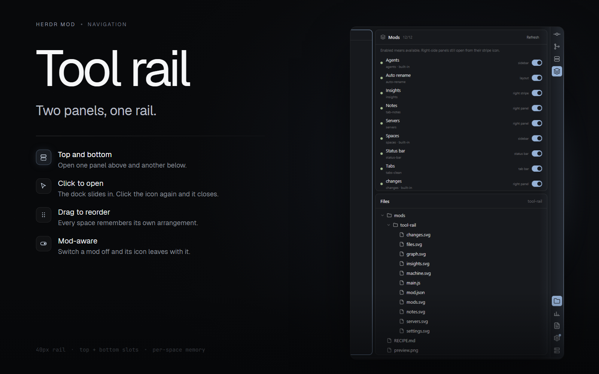

# Tool rail

A 40px icon rail down the right edge of Herdr, like IntelliJ's tool-window stripe. Click an icon to open its panel in the side dock; click it again to close that slot. The top group drives the top slot and the bottom group drives the bottom slot, so two panels can stay open at once — Mods above and Files below, for example. Drag icons to reorder them; each space keeps its own arrangement and open panels.



## Install

Ask the agent in your Herdr window:

> Read `~/.config/herdr-app/AGENTS.md`, then add this mod: https://github.com/riyhs/herdr-tool-rail

The mod is `place: none`; it draws only where the layout puts it. It expects a 40px rail block at the right edge of the work-body row and a dock column with the ids `panel`, `slot-top` and `slot-bottom`. On load it fills the slots with one `panel-<id>` block per rail icon. See [RECIPE.md](RECIPE.md) for the exact node tree and the layout rewrite.

## What it does

- 40px rail on the right edge, 30px icon buttons with 20px icons, 6px gaps and tooltips instead of labels.
- Two independent slots. Clicking an open icon closes only that slot; the dock hides when both are closed. Clicking another icon in the same group swaps that slot and keeps the other open.
- Drag to reorder icons or move one between the top and bottom groups. The arrangement persists per space.
- Hides icons and closes panels for mods that are switched off in the Mods menu.
- The Settings icon shows a 7px accent dot while a Herdr update is ready.
- Bundled icons for Files, Changes, Mods, Graph, Insights, Machine, Notes, Servers and Settings. Graph, Servers, Insights and Notes open those community mods; install them separately if you want those panels.

## Requirements

- Herdr desktop app.
- A layout with the rail block and the dock ids above. Without `panel`, `slot-top` and `slot-bottom`, the rail still draws but does not build panels.
- Optional: [Git Graph](https://github.com/rabeeh-ta/herdr-git-graph), [Servers](https://github.com/obrunogonzaga/herdr-mods/tree/main/servers-panel), [Insights](https://github.com/GaganSD/coding-agent-toolkit/tree/main/herdr-insights) and [Tab notes](https://github.com/ozcberkay/herdr-coban/tree/main/tab-notes) behind their icons.

## Files

- `mods/tool-rail/main.js` — rail, drag/drop, layout wiring, per-space state.
- `mods/tool-rail/mod.json` — `place: none`.
- `mods/tool-rail/*.svg` — the nine icons.
- `RECIPE.md` — the full build brief and expected layout.
- `preview.png` — the listing preview.

Lineage: grew out of kgonia's intellij-herdr-stripe, generalized into a layout-agnostic, reorderable rail.

## License

Apache-2.0. See [LICENSE](LICENSE).

Icon notices: `changes.svg`, `files.svg`, `machine.svg` and `settings.svg` are JetBrains icons, copyright 2000–2023 JetBrains s.r.o. and contributors, Apache-2.0. `mods.svg` and `notes.svg` are Lucide icons, copyright (c) 2026 Lucide Icons and Contributors, ISC. The ISC notice:

```text
ISC License

Copyright (c) 2026 Lucide Icons and Contributors

Permission to use, copy, modify, and/or distribute this software for any
purpose with or without fee is hereby granted, provided that the above
copyright notice and this permission notice appear in all copies.

THE SOFTWARE IS PROVIDED "AS IS" AND THE AUTHOR DISCLAIMS ALL WARRANTIES
WITH REGARD TO THIS SOFTWARE INCLUDING ALL IMPLIED WARRANTIES OF
MERCHANTABILITY AND FITNESS. IN NO EVENT SHALL THE AUTHOR BE LIABLE FOR
ANY SPECIAL, DIRECT, INDIRECT, OR CONSEQUENTIAL DAMAGES OR ANY DAMAGES
WHATSOEVER RESULTING FROM LOSS OF USE, DATA OR PROFITS, WHETHER IN AN
ACTION OF CONTRACT, NEGLIGENCE OR OTHER TORTIOUS ACTION, ARISING OUT OF
OR IN CONNECTION WITH THE USE OR PERFORMANCE OF THIS SOFTWARE.
```
