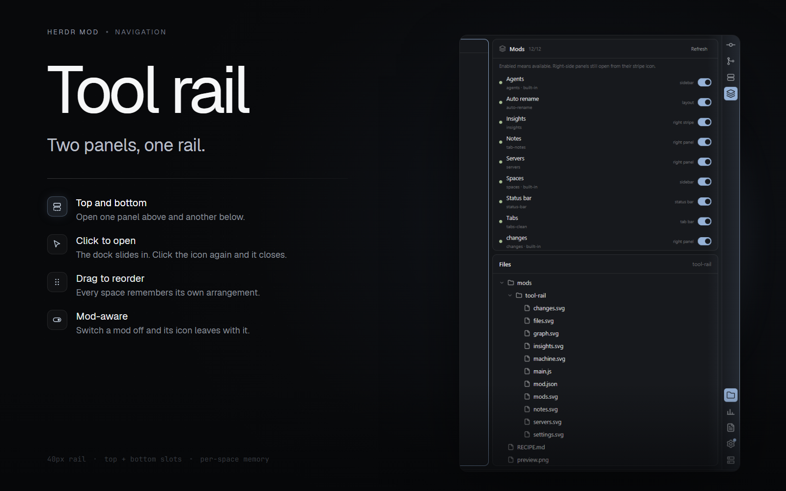

# Tool rail

A 40px icon rail down the right edge of the Herdr window, like IntelliJ's tool-window stripe. Click an icon and its panel opens in the side dock; click it again and that slot closes. The top group opens the top slot and the bottom group opens the bottom slot, so two panels can stay open at once — Mods above, Files below, or any pair you drag into place. Drag icons to reorder them; every space keeps its own arrangement and its own open panels. Icons for switched-off mods disappear with their panels.

## What you see

- The rail: a 40px fixed-width column at the right edge of the work area, `chrome` background, a 1px `border` line on its left. Icon buttons are 30px with 6px corners, 20px svg icons, 6px apart, 6px from the top and bottom edges. No labels; each icon's name shows as a tooltip after the pointer rests on it.
- The top group holds panel icons, a flexible gap pushes the bottom group down. Each open slot's icon is `accent` with `accent_foreground` text; every other icon is `muted` and turns `hover` with `foreground` text on pointer. An icon being dragged dims to 35% opacity, and a 2px `accent` drop line marks where it will land.
- The Settings icon carries a 7px `accent` dot at its top-right while a Herdr update is ready to install.
- The dock the rail opens into: a side column (368px by default, drag 280–900px) on `chrome`, holding a panel in its top slot and a panel in its bottom slot, separated by an 8px gap when both are open. Either slot can be open on its own; both start hidden.

## How it behaves

- Click a panel icon: the dock shows (`layout.show` on the `panel` column) and that mod's block shows in its group's slot (`panel-<id>`). Clicking an icon that is already open closes only its slot; the dock hides when both slots are closed. Clicking another icon in the same group swaps that slot's panel and keeps the other slot open.
- Drag an icon onto another icon's position: they swap, or the icon joins the other group. Any panel can live in either group; drag one across and its slot follows. The arrangement persists per space (`localStorage` key `stripe.spaces`) and globally (`stripe.items`, with `stripe.itemsVersion` for migrations). Dragging locks while that panel is open in any space, so an open panel never changes groups under you.
- Icons render only for mods that are on: the rail reads the shared key `mods.disabled` (written by the Mods menu mod) and hides those icons, closes their panels and hides their dock blocks. Re-enabling a mod brings its icon back.
- Insights is not a panel: it opens a new tab running the insights mod. Settings runs `app.settings`; Add machine opens the add-machine dialog (`mod.open machine-add`).
- Each space starts with the dock closed; switching spaces restores that space's own arrangement and open panels. Everything draws from the current theme's tokens.

## Built from

- `mod.json`: `place: none`, title "Tool window rail". The layout places it as a 40px block, id `stripe-right`, `mod: tool-rail`, at the right end of the work-body row.
- The layout must already contain the dock: a column with id `panel` (368px, hidden, `chrome`) whose children are `slot-top`, `panel-gap` and `slot-bottom` (columns of weight 1, and an 8px gap block using the shipped `panel-empty` mod). Given those three ids, `ensureLayout()` rewrites the column on load through `run("layout.set", ...)`: one hidden `panel-<id>` block per panel icon (`content.mod` from the icon registry, weight 1), and the 8px `panel-gap` if missing.
- `main.js`: an `ICONS` registry mapping each id to `{ label, panel?, mod?, action?, icon? }`; `DEFAULT_ITEMS` with the top and bottom groups; an `ITEMS_VERSION` migration that places new icons into saved arrangements; helpers `find`, `panelId`/`isPanelBlock`, `setHidden`, `normalizeState`. `render()` draws a `v_flex` of buttons, each an `svg(def.icon ?? "mods/tool-rail/<id>.svg")` of size 20.
- `herdr` functions used: `layout`, `run`, `spaces`, `theme`, `updates`, `shared`/`setShared` (it publishes `stripe.modIds`, the mod ids that have rail panels, so other mods can find them). Storage: `localStorage` keys `stripe.items`, `stripe.spaces`, `stripe.itemsVersion`; Herdr persists a mod's localStorage under `data/tool-rail/store.json`.
- Art: nine bundled svg icons — files, changes, graph, insights, machine, mods, notes, servers, settings.
- It runs no programs, reaches no network, and reads no files outside its own store.

## Watch out

- Without the three dock ids (`panel`, `slot-top`, `slot-bottom`) the rail still draws its icons but `ensureLayout()` refuses to build panels and notifies once. Start from the node tree above.
- The rail creates a `panel-<id>` block for every panel icon in `DEFAULT_ITEMS`, even when that mod is not installed, so an icon with no mod behind it opens an empty panel. Remove icons you don't have — dragging an icon out is not enough, edit `DEFAULT_ITEMS` (and bump `ITEMS_VERSION`).
- The Git Graph, Servers, Insights and Notes icons are bundled, but their panels need those community mods installed: rabeeh-ta/herdr-git-graph, obrunogonzaga's servers panel, GaganSD's insights, ozcberkay's tab-notes.
- Dragging locks while the dragged panel is open in any space; the drop line is the only feedback while dragging.
- Lineage: this grew out of kgonia's intellij-herdr-stripe (a 54-line Files/Changes stripe inside the IntelliJ recolor layout), generalized into a layout-agnostic, reorderable rail that any mod can dock into.

## Done when

- `herdr-app check mods/tool-rail` passes.
- With the node tree above in a layout, the rail draws its icons at the right edge; clicking Files opens the Files panel in the top slot.
- With Files in the bottom group, clicking it opens the bottom slot; Mods stays open above, separated by the 8px gap. Clicking either icon closes only its slot, and the dock hides once both are closed.
- Dragging Changes above Files survives switching to another space and back.
- With the Mods menu mod installed, switching a mod off removes its rail icon and closes its panel; switching it back restores both.
- The Settings dot appears while a Herdr update is ready to install.
